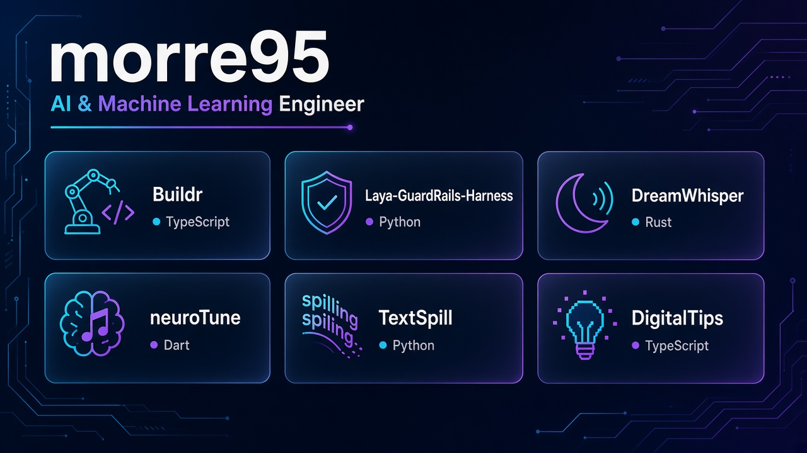

# Hi there, I'm Erik Morén! 👋

  

---

### 💫 About Me
I'm a **AI engineer student** passionate about building cool AI stuff. Currently, I'm focusing on **[neuroTune](https://github.com/morre95/neuroTune)**.

- 🔭 I’m currently working on **DreamWhisper**
- 🌱 I’m currently learning **AI stuff**
- 👯 I’m looking to collaborate on **DigitalTips**
- 💬 Ask me about **meditation**

---

## 🖥️ Tech Stack

### 🤖 AI & Machine Learning

  

  
  
  
  
  
  
  
  
  
  
  

### 💬 Languages

  

### ⚙️ Frameworks & Backend

  

### 🗄️ Databases

  

### ☁️ Cloud & DevOps

  

---

### 📊 GitHub Stats

---

### 📫 Connect with me

